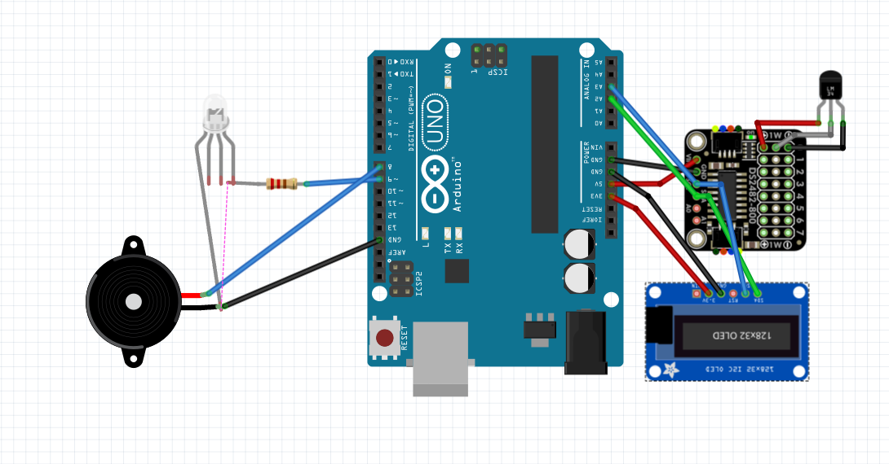

# IoT Temperature Monitor

An Arduino-based temperature monitor that reads an **LM34** sensor, displays
live readings on a **SSD1306 OLED**, and raises a visual + audible alarm when
the temperature leaves a configurable range.


<p align="center">
  
</p>

---

## Table of contents

- [Overview](#overview)
- [Features](#features)
- [Hardware](#hardware)
- [Wiring](#wiring)
- [Repository structure](#repository-structure)
- [Getting started](#getting-started)
- [Configuration](#configuration)
- [How it works](#how-it-works)
- [Optional: DS2482S-800 1-Wire expansion](#optional-ds2482s-800-1-wire-expansion)
- [Design notes](#design-notes)
- [Roadmap](#roadmap)
- [License](#license)
- [Author](#author)

---

## Overview

This project is an Electrical & Computer Engineering prototype of a local
temperature monitor. An **LM34** analog sensor is sampled by the Arduino's ADC;
the result is converted to both Celsius and Fahrenheit, shown on a small OLED
and printed to the serial port. When the temperature crosses a high or low
threshold, an LED blinks and a passive buzzer beeps until the reading returns
inside the safe range (with hysteresis to avoid chatter).

The firmware is written with a small, modular C++ structure and is intentionally
**non-blocking** — the sensor, display and alarm all run on their own timers so
the sketch stays responsive.

## Features

-  **LM34 analog sensing** with oversampling / averaging for a stable reading.
-  **SSD1306 128×32 OLED** output (large Fahrenheit value + Celsius + status).
-  **High / low alarm** with hysteresis, a PWM-blinking LED and a passive buzzer.
-  **Min / max tracking** since power-on, logged over serial.
-  **Fully configurable** pins, thresholds and timing via `config.h`.
-  **Modular code** (`LM34`, `Display`, `Alarm`) with no blocking `delay()` in `loop()`.
-  **Optional 8-channel expansion** example for the DS2482S-800 + DS18B20.

## Hardware

| Qty | Component                                        |
| :-: | ------------------------------------------------ |
|  1  | Arduino Uno Rev3                                 |
|  1  | LM34 precision Fahrenheit temperature sensor     |
|  1  | SSD1306 128×32 I2C OLED (`0x3C`)                 |
|  1  | LED + 220 Ω resistor                             |
|  1  | Passive buzzer                                   |
|  1  | Adafruit DS2482S-800 8-ch 1-Wire adapter *(optional)* |
|  —  | Breadboard and jumper wires                      |

## Wiring

| Signal              | Arduino pin | Peripheral       |
| ------------------- | :---------: | ---------------- |
| LM34 output         | **A0**      | LM34             |
| LM34 `+Vs` / `GND`  | **5V / GND**| LM34             |
| I2C SDA             | **A2**      | OLED (+ DS2482)  |
| I2C SCL             | **A3**      | OLED (+ DS2482)  |
| OLED `VCC` / `GND`  | **3.3V / GND** | OLED          |
| LED (via 220 Ω)     | **D9**      | LED anode        |
| Buzzer `+`          | **D8**      | Passive buzzer   |

See **[`docs/wiring.md`](docs/wiring.md)** for the full pin map, the bill of
materials, and three corrections that were applied to the original schematic.

## Repository structure

```
IoT_Temperature_Monitor/
├── firmware/
│   └── IoT_Temperature_Monitor/        # Main Arduino sketch
│       ├── IoT_Temperature_Monitor.ino # Setup / loop
│       ├── config.h                    # Pins, thresholds, timing
│       ├── lm34.{h,cpp}                # LM34 analog sensor driver
│       ├── display.{h,cpp}             # SSD1306 OLED rendering
│       └── alarm.{h,cpp}               # LED + buzzer alarm
├── examples/
│   └── ds2482_8channel_scan/           # Optional DS18B20 over DS2482S-800
├── docs/
│   └── wiring.md                       # Wiring + assembly notes
├── hardware/
│   ├── IoT-Temp-Monitor_schematic.fzz  # Fritzing source
│   └── IoT-Temp-Monitor_schematic.png  # Exported schematic
├── CHANGELOG.md
├── LICENSE
└── README.md
```

## Getting started

### Prerequisites

- [Arduino IDE](https://www.arduino.cc/en/software) 1.8.x or 2.x
- Arduino Uno board package (`Tools → Board → Arduino AVR Boards → Arduino Uno`)
- The **U8g2** library by Oliver (olikraus)

### Install the library

In the Arduino IDE: **Tools → Manage Libraries…**, search for **U8g2** and
install it. (Optional, only for the DS2482 example: install **Adafruit DS248x**
and **Adafruit BusIO**.)

### Build and upload

1. Open `firmware/IoT_Temperature_Monitor/IoT_Temperature_Monitor.ino`.
2. Select **Tools → Board → Arduino Uno** and the correct **Port**.
3. Click **Upload**.
4. Open the **Serial Monitor** at **115200 baud** to watch the readings.

## Configuration

Everything is set in [`firmware/IoT_Temperature_Monitor/config.h`](firmware/IoT_Temperature_Monitor/config.h):

| Define                  | Default | Description                                  |
| ----------------------- | :-----: | -------------------------------------------- |
| `USE_SOFT_I2C`          |   `1`   | `1` = software I2C on A2/A3, `0` = hardware I2C (A4/A5) |
| `TEMP_HIGH_C`           | `30.0`  | High-temperature alarm threshold (°C)        |
| `TEMP_LOW_C`            | `10.0`  | Low-temperature alarm threshold (°C)         |
| `TEMP_HYSTERESIS_C`     |  `1.0`  | Hysteresis around the thresholds (°C)        |
| `ADC_VREF`              |  `5.0`  | ADC reference voltage (V)                    |
| `ADC_SAMPLES`           |   `10`  | Samples averaged per reading                 |
| `LM34_CAL_OFFSET_F`     |  `0.0`  | Calibration offset (°F)                      |
| `BUZZER_FREQ_HZ`        | `2000`  | Passive buzzer tone frequency (Hz)           |

## How it works

1. **Sense** – `LM34::readFahrenheit()` averages `ADC_SAMPLES` ADC reads, turns
   the voltage into degrees Fahrenheit (`10 mV / °F`) and Celsius
   (`°C = (°F − 32) × 5/9`).
2. **Display** – every 250 ms the OLED is redrawn: status (OK/HIGH/LOW),
   the Celsius value, and the large Fahrenheit value.
3. **Alarm** – `Alarm::update()` applies hysteresis and, when out of range,
   blinks the LED (PWM) and beeps the buzzer in a 200 ms / 800 ms pattern.
4. **Log** – once per second the reading, min/max and alarm state are printed
   to the serial monitor.

Because `loop()` never blocks, the sampling, display refresh and alarm all run
independently on their own timers.

## Optional: DS2482S-800 1-Wire expansion

The DS2482S-800 in the bill of materials is a **1-Wire master** for digital
sensors such as the **DS18B20** — it cannot read the analog LM34. The
[`examples/ds2482_8channel_scan`](examples/ds2482_8channel_scan/ds2482_8channel_scan.ino)
sketch shows how to read up to eight DS18B20 sensors, one per channel, using the
Adafruit DS248x library.

## Design notes

- The LM34 is an **analog** Fahrenheit sensor (`10 mV/°F`); the
  **DS2482S-800** is a **digital 1-Wire master**. They are electrically
  incompatible, so the LM34 is read directly by the Arduino ADC and the
  DS2482S-800 is offered as an optional expansion (§ above).
- The original schematic wires I2C to **A2/A3**, which are not the Uno's
  hardware-I2C pins, so the firmware defaults to **software I2C**. Set
  `USE_SOFT_I2C` to `0` after moving to A4/A5 for a more robust bus.
- The **220 Ω** resistor is the LED current limiter (the LED cathode must go to
  GND).

See [`docs/wiring.md`](docs/wiring.md#3-corrections-applied-to-the-original-schematic)
for the complete list of corrections.

## Roadmap

- [ ] Add an ESP8266/ESP32 variant with Wi-Fi (MQTT / dashboard).
- [ ] Log readings to an SD card or EEPROM.
- [ ] Add a push-button to set thresholds at runtime.
- [ ] Add unit-tests for the temperature conversion helpers.

## License

Released under the **MIT License**. See [`LICENSE`](LICENSE) for details.

## Author

**Gift Sato Kuepouo** — Electrical & Computer Engineering project.
